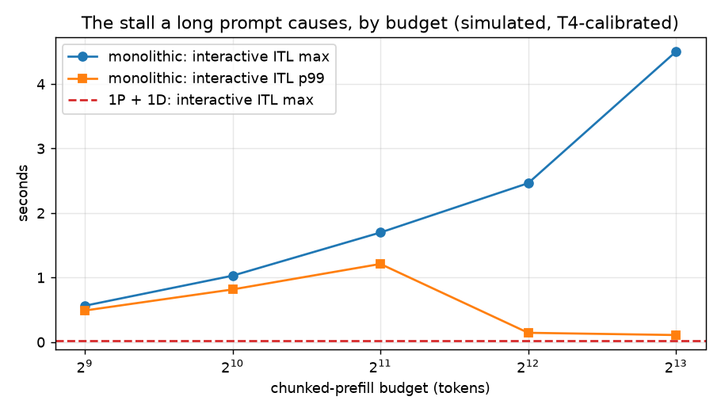
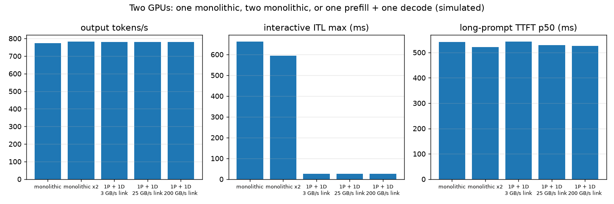
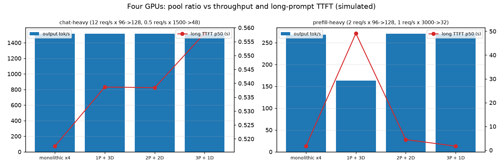
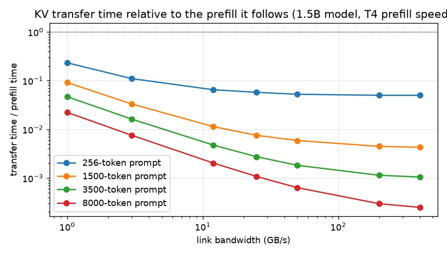
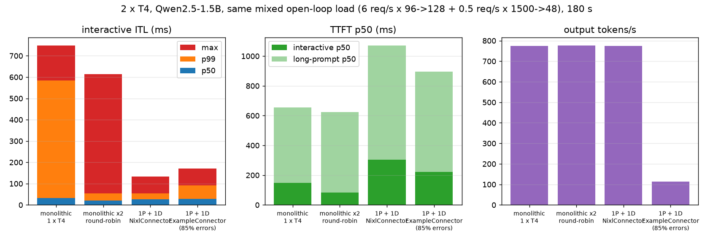

# splitserve

Disaggregated prefill/decode LLM serving: separate GPU pools with KV transfer, measuring the throughput and latency deltas against a monolithic server.

Project 10 of 15 in [inference-infra-portfolio](https://github.com/NomanJafar/inference-infra-portfolio).

## What this builds

- **A P/D proxy** (`splitserve-proxy`): one OpenAI-compatible endpoint in front of vLLM prefill and decode instances. It implements the NixlConnector handshake (prefill with `max_tokens=1` and `kv_transfer_params.do_remote_decode`, forward the returned block ids and side-channel address to the decode instance), the ExampleConnector variant (KV via a shared directory, matched by token hash), and a round-robin mode for monolithic replicas so the three can be compared through the same door. Every request is timed at each hop: the prefill round-trip and the handoff (decode request to first byte, which includes the KV transfer).
- **An event-driven simulator** (`splitserve-sim`): monolithic instances with chunked prefill, prefill-only and decode-only instances, and a link with a per-byte cost. Every parameter is a number measured elsewhere in this portfolio: decode step time against batch size and short-prompt prefill from [servellm](https://github.com/NomanJafar/servellm), long-prompt prefill from [chunkedprefill-lab](https://github.com/NomanJafar/chunkedprefill-lab), KV bytes per token from [kvcalc](https://github.com/NomanJafar/kvcalc). It answers what two T4s cannot: pool ratios, link speeds, four-GPU layouts.
- **A 2 x T4 experiment** (`notebooks/kaggle_splitserve.ipynb`): the same mixed open-loop load through one monolithic server, two monolithic replicas, 1P + 1D over NIXL, and 1P + 1D over a shared directory.

[CONCEPTS.md](CONCEPTS.md) is the primer: why the two phases fight over one GPU, what splitting them buys and costs, how the KV cache crosses, and what a two-GPU toy can and cannot show.

## Why it matters

This is the architecture behind every frontier serving stack in 2026. Knowing what it fixes (tail inter-token latency, independent sizing of the two phases) and what it does not (throughput) is the difference between adopting it and cargo-culting it.

## Status

Done. Two measured runs on Kaggle's 2 x T4 (below, the second a reproduction with complete raw files), with the simulator's predictions next to them.

## Simulated results

`splitserve-sim --out results/sim` (120 s traces, Poisson arrivals, seed 0; tables in [results/sim/summary.md](results/sim/summary.md)).

### 1. The stall, and the knob that only resizes it

Interactive stream (4 req/s, 64-token prompts, 128 out) plus 0.25 req/s of 3,500-token prompts on one monolithic GPU, chunk budget swept; then the same load on 1P + 1D.

| condition | interactive ITL p50 | p99 | **max** | interactive TTFT p50 | long TTFT p50 |
|---|---|---|---|---|---|
| budget=512 | 26.6 ms | 489 ms | **0.56 s** | 369 ms | 2.51 s |
| budget=1024 | 25.8 ms | 816 ms | **1.03 s** | 135 ms | 2.37 s |
| budget=2048 | 25.5 ms | 1211 ms | **1.70 s** | 90 ms | 2.31 s |
| budget=4096 | 25.5 ms | 144 ms | **2.46 s** | 90 ms | 2.24 s |
| budget=8192 | 25.5 ms | 109 ms | **4.50 s** | 89 ms | 2.23 s |
| interactive only | 18.1 ms | 31 ms | 39 ms | 40 ms | – |
| **1P + 1D** | 18.5 ms | 27 ms | **27 ms** | 60 ms | 2.24 s |



The model reproduces the shape chunkedprefill-lab measured on a real T4: the maximum grows with the budget while p99 collapses once a long prompt fits in one chunk (the lab saw p99 152 ms against a 3.48 s maximum at budget 4096; the model gives 144 ms against 2.46 s for the smaller model). The pair removes the stall by construction: interactive ITL max 27 ms, within 10 ms of the "interactive only" line.

### 2. Two GPUs: replicate or split

6 req/s interactive (96 → 128) plus 0.5 req/s long (1,500 → 48), the load the notebook uses.

| condition | GPUs | out tok/s | interactive TTFT p50 | interactive ITL p50 / p99 / max | long TTFT p50 |
|---|---|---|---|---|---|
| monolithic | 1 | 773 | 67 ms | 27.6 / 527 / 661 ms | 542 ms |
| monolithic x2 | 2 | 782 | 43 ms | 17.5 / 36 / 595 ms | 521 ms |
| 1P + 1D, 3 GB/s link | 2 | 781 | 55 ms | 20.6 / 24 / 25 ms | 542 ms |
| 1P + 1D, 25 GB/s link | 2 | 781 | 54 ms | 20.6 / 24 / 25 ms | 529 ms |
| 1P + 1D, 200 GB/s link | 2 | 781 | 54 ms | 20.6 / 24 / 25 ms | 527 ms |



At this load none of the layouts is throughput-bound, so tokens per second are identical and the differences are all latency structure. Two replicas halve the median ITL but each replica still stalls (max 595 ms); the pair has a slightly higher median (one GPU decodes the whole batch) and no stall at all. The link barely matters for a 1.5B model: a 1,500-token prompt's KV is 43 MB, 16 ms at 3 GB/s against a 490 ms prefill.

### 3. Four GPUs: the ratio has to match the load

| load | layout | out tok/s | interactive ITL p99 / max | long TTFT p50 |
|---|---|---|---|---|
| chat-heavy (12 req/s x 96→128, 0.5 req/s x 1500→48) | monolithic x4 | 1,516 | 33 / 533 ms | 517 ms |
| | 1P + 3D | 1,515 | 20 / 21 ms | 539 ms |
| | 2P + 2D | 1,517 | 22 / 23 ms | 538 ms |
| | 3P + 1D | 1,511 | 39 / 41 ms | 558 ms |
| prefill-heavy (2 req/s x 96→128, 1 req/s x 3000→32) | monolithic x4 | 268 | 796 / 1,427 ms | 1.70 s |
| | 1P + 3D | 163 | 16 / 16 ms | **49 s** (prefill pool saturated) |
| | 2P + 2D | 271 | 17 / 17 ms | 4.47 s |
| | 3P + 1D | 271 | 19 / 20 ms | 1.72 s |



A 3,000-token prompt costs about 1.65 s of prefill on this GPU, so one request per second needs more than one prefill GPU; 1P + 3D falls over while 3P + 1D matches four monolithic replicas on TTFT and beats them on tail ITL by 70x. Disaggregation turns "how many GPUs" into "how many of each", and the second question has a wrong answer the first does not.

### 4. When the transfer matters



For this model on this GPU the KV transfer is never more than a quarter of the prefill it follows, even at 1 GB/s, because the T4 prefills slowly (0.1 ms per token and up) while 28 KB per token crosses even a slow link in 0.03 ms. The ratio flips on hardware that prefills 50x faster with a model whose KV per token is larger: there the link is the design constraint, which is why production stacks run it over NVLink or RDMA.

## Measured results (2 x T4, Kaggle, 18 Oct 2026)

vLLM 0.31.0, Qwen2.5-1.5B-Instruct fp16, one instance per T4 via `CUDA_VISIBLE_DEVICES`, `nixl` 1.4.1 over UCX on the same host. The same load through the proxy in every condition: 6 req/s of 96-token prompts with 128-token answers plus 0.5 req/s of 1,500-token prompts with 48-token answers, unique prompts, 180 s, after a 20 s warm-up that is discarded. Raw files in [results/kaggle_run1/](results/kaggle_run1/).

| condition | GPUs | out tok/s | interactive TTFT p50 / p95 | interactive ITL p50 / p99 / **max** | long TTFT p50 / p95 | proxy: prefill hop p50 | proxy: handoff p50 | errors |
|---|---|---|---|---|---|---|---|---|
| monolithic | 1 | 775 | 148 / 803 ms | 32.9 / 584 / **749 ms** | 655 / 1,153 ms | – | – | 0 |
| monolithic x2, round-robin | 2 | 777 | 84 / 474 ms | 19.8 / 55 / **613 ms** | 623 / 804 ms | – | – | 0 |
| **1P + 1D, NixlConnector** | 2 | 774 | 303 / 1,272 ms | 26.7 / 54.8 / **134 ms** | 1,072 / 1,549 ms | 100 ms | 212 ms | 0 |
| 1P + 1D, ExampleConnector | 2 | 114 | 222 / 952 ms | 27.5 / 91.6 / 171 ms | 897 / 1,141 ms | 125 ms | 138 ms | **984 of 1,158** |



"Prefill hop" is the proxy's round-trip to the prefill instance (one token, `kv_transfer_params.do_remote_decode`); "handoff" is from sending the decode request to its first byte, which contains the NIXL read of the KV blocks plus the decode instance's own scheduling. 1,158 requests per condition; 0 errors except where stated.

### What the numbers say

1. **Disaggregation removed the stall, and it was the only thing that did.** Interactive ITL max went from 749 ms (one monolithic server) and 613 ms (two monolithic replicas: each still prefills 1,500-token prompts in its own decode loop) to 134 ms with a dedicated decode GPU; p99 fell from 584 ms to 55 ms. The simulator predicted 661 / 595 / 25 ms for the same three layouts; it got the structure right and the residual wrong, because a real decode instance still has scheduling jitter and the Triton attention kernel's own variance, which a step-cost model does not.
2. **The price was TTFT, and it was larger than the link cost.** Interactive TTFT p50 rose from 84 ms (two replicas) to 303 ms; long-prompt TTFT from 623 to 1,072 ms. The proxy's timings split that: about 100 ms for the prefill hop (an HTTP request to a GPU that is doing nothing but prefill, so this is mostly the prefill itself) and 212 ms for the handoff. The KV bytes for a 96-token prompt are under 3 MB; even over host memory that is a millisecond. The handoff is dominated by the second request's trip through vLLM's front end and scheduler and the asynchronous NIXL read being polled per step, not by bandwidth. The simulator's 16 ms link cost was the wrong thing to model for this setup; the two extra scheduler passes were the cost.
3. **Throughput was identical across the three working layouts** (774 to 777 tok/s) because the load was chosen below saturation for one GPU: this run measures latency structure, not capacity. The P GPU was mostly idle (6.5 prefills per second at ~100 ms each), which is the throughput argument against 1P + 1D in one sentence.
4. **The two monolithic replicas halved the median ITL** (32.9 to 19.8 ms) by halving each decode batch, and the P/D pair sat between them (26.7 ms) because its single decode GPU carries the whole batch. Median latency favours replication; tail latency favours splitting.
5. **vLLM's ExampleConnector is a debug tool, and under load it behaved like one.** The decode instance's engine died 90 s into the run with `shape mismatch: value tensor of shape [1456, 2, 256] cannot be broadcast to indexing result of shape [1536, 2, 256]`, a partial-block alignment error when loading a stored prompt's KV, and every request after that was a 502 from the proxy (`results/kaggle_run1/startup_shared_gpu1.log`). Up to the crash, its handoff (138 ms) was no worse than NIXL's, because at 3 MB per prompt even a filesystem round-trip is cheap on this model. The 29,000 files it left in the kernel's output directory are their own argument against it.
6. **Cold start was the same for all layouts** (103 to 163 s to `/health`, two instances starting in parallel), so disaggregation does not change the autoscaling arithmetic from [gpuscaler](https://github.com/NomanJafar/gpuscaler).

### Reproduction (run 2, same night)

The run was repeated with unique file tags and the KV store moved out of the kernel output ([results/kaggle_run2/](results/kaggle_run2/), raw files for every condition this time):

| condition | out tok/s | interactive TTFT p50 | interactive ITL p50 / p99 / **max** | long TTFT p50 | handoff p50 | errors |
|---|---|---|---|---|---|---|
| monolithic | 776 | 136 ms | 30.7 / 572 / **1,130 ms** | 645 ms | – | 0 |
| monolithic x2 | 779 | 75 ms | 18.1 / 47.5 / **591 ms** | 608 ms | – | 0 |
| 1P + 1D, NixlConnector | 775 | 305 ms | 23.4 / 50.3 / **129 ms** | 1,067 ms | 208 ms | 0 |
| 1P + 1D, ExampleConnector | 187 | 235 ms | 24.1 / 82.5 / 201 ms | 963 ms | 138 ms | 878 of 1,158 |

Medians, p99s, TTFTs and the handoff reproduce within a few percent; the maxima are single events and moved (the monolithic server's worst stall was 749 ms in run 1 and 1,130 ms in run 2). The ExampleConnector decode engine crashed again, the same way.

### What was not measured

- Run 1's two P/D conditions shared a file tag, so its `load_1P_p_1D_*` and `records_1P_p_1D.json` files belong to the ExampleConnector condition; the NixlConnector numbers in run 1's table come from the notebook's in-memory `runs.json`. Run 2 has complete raw files for every condition.
- No load level above one GPU's capacity, so no measurement of the throughput cost of splitting; the simulator's section 2 covers it and the saturation point is in [tokenbench](https://github.com/NomanJafar/tokenbench)'s open-loop sweep.
- Two runs, one seed each, 180 s per condition. The ITL maxima are single events; the p99s and medians are over roughly 140,000 inter-token gaps each and reproduced across the two runs.
- P:D ratios other than 1:1, and a link slower or faster than two T4s on one PCIe host.

## Layout

| path | what |
|---|---|
| `CONCEPTS.md` | the primer |
| `src/splitserve/proxy.py` | the P/D proxy (`splitserve-proxy --mode nixl\|shared\|replicas --prefill URL --decode URL`), `/records`, `/metrics` |
| `src/splitserve/sim.py` | `SimConfig`, `monolithic()`, `disaggregated()`, `prefill_ms()`, `transfer_ms()` |
| `src/splitserve/trace.py` | Poisson mixed traces |
| `src/splitserve/analysis.py` | tokenbench JSON and proxy records to comparison rows and Markdown |
| `src/splitserve/cli.py` | `splitserve-sim`: the four scenarios, tables and plots |
| `tests/` | 18 tests: the handshake against a fake vLLM pair that speaks it, the simulator's calibration and claims, the analysis helpers |
| `notebooks/kaggle_splitserve.ipynb` | the 2 x T4 experiment |
| `results/sim/` | simulated tables and plots |

## Running

```bash
python -m venv .venv && source .venv/bin/activate
pip install -e ".[dev]"
pytest
splitserve-sim --out results/sim                 # a few seconds; tables and plots
# against real vLLM instances (same host, two GPUs):
CUDA_VISIBLE_DEVICES=0 VLLM_NIXL_SIDE_CHANNEL_PORT=5600 vllm serve Qwen/Qwen2.5-1.5B-Instruct --port 8100 \
  --kv-transfer-config '{"kv_connector":"NixlConnector","kv_role":"kv_producer"}'
CUDA_VISIBLE_DEVICES=1 VLLM_NIXL_SIDE_CHANNEL_PORT=5601 vllm serve Qwen/Qwen2.5-1.5B-Instruct --port 8200 \
  --kv-transfer-config '{"kv_connector":"NixlConnector","kv_role":"kv_consumer"}'
splitserve-proxy --mode nixl --prefill http://127.0.0.1:8100 --decode http://127.0.0.1:8200 --port 8080
tokenbench sweep --base-url http://127.0.0.1:8080 --model Qwen/Qwen2.5-1.5B-Instruct --mode open --levels 6 --duration 120 --prompts unique --out results/chat.json
```

## What the simulator leaves out

No KV-cache capacity limit or preemption (servellm never got near the limit with this model), no prefix caching, no network variance, a fixed per-step cost model with no CUDA-graph or kernel-launch effects, and round-robin placement only. It is a model of the scheduler's arithmetic, checked against measured behaviour in one configuration, not a performance predictor for another GPU.

## Hardware notes

Developed against free-tier GPUs (Kaggle and Colab T4, 16 GB). Where a T4 limits what can be measured (no FP8, Turing-era kernels, PCIe without GPUDirect between the two cards), the README says so rather than papering over it.

## License

MIT
